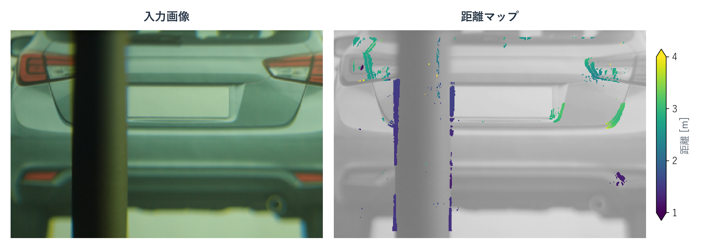
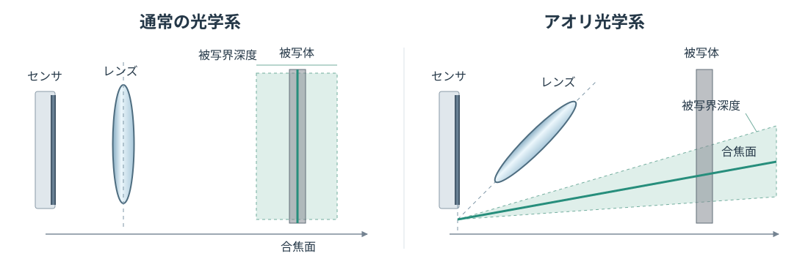

# アオリ光学系とカラーフィルタ開口による単眼ビデオレート測距

1台のカメラにアオリ光学系と分割型カラーフィルタ開口を組み合わせ、映像の色ずれから距離をフレームごとに求めるリアルタイム実装。



手前の筒と奥の印刷画像の例。色の付いた点が推定距離で、背景には入力画像を重ねている。

## このリポジトリについて

アオリ光学系と色視差を使った単眼測距を、実際に動くシステムとして実装した**過去の実装例**である。同じ分野の研究や実装を考えている人が、システム全体と内部の処理を読んで理解し、自分の実装の参考にしたり、利用・拡張したりすることを想定して公開している。

- 先行研究（参考論文）の考え方に基づき、視差の計算・校正・リアルタイム実行・検証までを一通り実装している。視差計算の骨格は、先行実装の [TiltedOpticsDepthIntro](https://github.com/aoifukino/TiltedOpticsDepthIntro)（MIT）のコードを元にしている（[NOTICE](NOTICE) を参照）。Rust への移植、RANSAC による校正、映像入出力、リアルタイム表示などをこのリポジトリで加えた。
- 厳密な研究成果や商用品質を保証するものではない。**無保証**で、実機・環境が変わると再校正が必要になる。
- 今後の研究には直接使わない予定のため、保守・更新は基本的に行わない。

## 測距の原理

ぼけによる色ずれの大きさと、画像のどの行に写ったかの2つから距離を求める。以下の撮影画像と散布図は、2.4 m に置いた同じパターン板の撮影から作成した。

### 1. アオリ光学系：行ごとにピントの合う距離が変わる

通常のカメラでは、画面全体で同じ距離にピントが合う。レンズを傾けると合焦面が傾き、画像の行ごとにピントの合う距離が変わる。本装置では、上の行ほど遠く、下の行ほど近い距離にピントが合う。これにより、通常の単眼カメラより広い距離範囲で、ぼけを距離の手掛かりにできる。



そのため、同じ距離の板を撮影しても、ピントの合う中央付近だけが鮮明で、上下の端に近いほどぼける。


### 2. 分割型カラーフィルタ開口：ぼけが色ずれになる

開口を左右でシアン（C）とイエロー（Y）に分ける。赤の光はイエロー側、青の光はシアン側の半開口だけを通る。ピントが合った点ではどちらの光もセンサ上の同じ位置に集まるが、ピントが外れると赤の像と青の像が左右逆向きにずれる（色視差）。色視差はピントの合う距離から離れるほど大きく、手前か奥かで向きが反転する。


上の写真の白枠を拡大したもの。上部では板がその行のピントの合う距離より手前、下部では奥にあるため、色の並びが反転している。

### 3. 行と色視差から距離を求める

色視差は、物体の距離と写った行の両方で決まる。そこで、既知の距離で撮影した画像から両者の関係を求めておく（校正）。下図は2.4 mの板から得た行 y と色視差 d の散布図で、点はほぼ直線 `y = a·d + b` に並ぶ。上部（pos、d > 0）と下部（neg、d < 0）で符号が分かれるのは、2の拡大画像で色の並びが反転していたのと同じ理由である。直線を色視差0まで延ばした行 b（図では pos が約115行、neg が約155行）が、2.4 m にピントが合う行の目安になる。図のように正負で直線が異なるため、以降の係数も正負で別々に求める。


距離を変えて撮影し b を集めると、ピントの合う行と距離 z の関係 `b = v/z + u` が得られる。推論では、写った行 y と色視差 d から「色ずれを0に戻したときの行」`y − ā·d` を求め（ā は各距離での傾き a の平均）、この関係に当てはめて距離を出す。

```text
z = v / (y − ā·d − u)
```

係数 v・u・ā は色視差の正負（図の pos・neg）ごとに持ち、推論時は d の符号で使い分ける。`w`（式の定数項）は 0 に固定している。

## 処理の流れ


色ずれは水平方向にしか生じないため、縦エッジ付近で色視差を求め、有効な視差を距離へ変換する。1フレームの処理は次の5段で、Pythonが入出力・表示、Rustが視差計算を担当する。

| 段 | 内容 | 対応するファイル |
|---|---|---|
| 1. 前処理 | 1280×720 の入力を 3:2 に中央切出しし、528×352 に縮小する | `realtime/camera.py`（`preprocess`） |
| 2. R/B 分割 | 赤チャンネル（基準）と青チャンネル（探索側）に分ける | `realtime/pipeline.py` |
| 3. 縦エッジの選別と ZNCC | 両チャンネルに水平方向の Sobel をかけ、赤の勾配が閾値（`EDGE_TH`）を超える画素だけを対象にする。各画素で、赤の窓（`KERNEL_SIZE`）に対し、青の窓を水平に `SEARCH_RANGE_X` 通りずらして ZNCC（正規化相互相関）を計算し、最大のずれを 3 点放物線で小数画素まで補間して、符号付きの色視差 d とする。対象外や決められない画素は NaN（0 で埋めない） | `core/disparity.py`（入口）、`rust/disparity/src/lib.rs`（本体）、`core/_disparity_reference.py`（照合用の Python 実装） |
| 4. 有効な視差の帯 | 合焦面の近く（\|d\| ≤ `INFER_BAND_LOW`）と、ぼけが大きすぎる域（\|d\| ≥ `INFER_BAND_HIGH`）を NaN にする | `realtime/pipeline.py`、`config.py` |
| 5. 距離への変換 | 参照式 `z = v / (y − ā·d − u)` に、行 y と色視差 d、係数（`params/fit_result.csv`）を当てはめる | `core/depth.py`、`core/params.py` |

校正（係数を求める工程）は `calibration/` にある。画素ごとの視差から、距離ごとの行 b と傾き a を RANSAC で求め（`calibrate.py`）、距離と b の関係 `b = v/z + u` を当てはめて係数 v・u・ā を決める（`fit_params.py`）。

## コードの読み順

全体の流れをつかむには、次の順に読むのがよい。

1. `realtime/pipeline.py`：1フレームの処理（約 60 行。上の 5 段の骨格）
2. `core/disparity.py`、`rust/disparity/src/lib.rs`：視差の計算。`core/_disparity_reference.py` の Python 実装の方が読みやすい
3. `core/depth.py`、`core/params.py`：距離への変換と係数の読込
4. `calibration/calibrate.py` → `calibration/fit_params.py`：校正
5. `realtime/runner.py`：映像の取得、表示、録画（取得スレッドと計算ループの分離）
6. `config.py`：すべての定数（窓の大きさ、探索幅、閾値、表示レンジなど）

## 使用機材

| 項目 | 内容 |
|---|---|
| カメラ | Canon EOS R10（センサ 22.3×14.9 mm、有効約2,420万画素） |
| レンズ | FUJINON SWD 90mm F5.6 |
| アオリ機構 | アオリ撮影用アダプタ |
| 開口フィルタ | 開口を左右でシアンとイエローに2分割したカラーフィルタ |
| 映像入力 | EOS Webcam Utility Pro（USB）。1280×720を3:2に中央切出しし、528×352に縮小して処理 |

## 実行手順

**動作確認環境**：Windows 11 / PowerShell、Python 3.14（uv）、Rust（cargo）、maturin（`uv tool install maturin`）。Linux・macOS は未検証で、Webcam の取得は Windows（MSMF）を前提にしている。

最初に、依存関係を入れ、Rust拡張をビルドして導入する。**Rust拡張が無いと、視差計算を使うコードは `import` の時点で失敗し、`pytest` も止まる。** `uv sync` を実行すると導入した拡張は削除されるので、実行後はビルドと導入をやり直す。

```powershell
uv sync
cd rust\disparity
maturin build --release --interpreter ..\..\.venv\Scripts\python.exe
uv pip install (Get-ChildItem target\wheels\*.whl).FullName
cd ..\..
```

以降は、必要なものによって 3 つに分かれる。

### A. データも実機も要らないもの

```powershell
uv run python -m pytest                                   # 自動テスト（合成データのみ）
uv run python -m checks.bench_disparity --impl native     # 視差計算の速度（合成入力。最悪ケース寄りで、予算超の exit 1 が正常）
uv run python -m checks.verify_disparity_rust --allow-synthetic-only   # Rust 版と Python 参照実装の数値照合（数分かかる）
uv run python -m realtime.runner --source still --path assets\sample\calib_2400mm_raw.png --no-record   # 同梱サンプルから距離マップを表示（q / Esc で終了）
```

同梱のサンプル `assets/sample/calib_2400mm_raw.png` は、2.4 m に置いたパターン板を撮影した校正画像（1280×720）で、`params/` の係数で距離を求めると約 2.4 m になる。

### B. 自前の撮影データが要るもの

`data/` の下は空（`.gitkeep` のみ）で、校正画像・撮影データ・テスト画像は同梱していない。

- **校正**：既知の距離で撮影した画像を `data/calib_imgs/<距離mm>.png`（528×352 に前処理した画像）として置き、`uv run python -m calibration.calibrate` → `uv run python -m calibration.fit_params` で係数を作る。`calibrate` は `params/params.csv`、`fit_params` は `params/fit_result.csv` を上書きする。
- **回帰の確認**：`checks.evaluate` と `checks.verify_pipeline_equivalence` は、著者の静止画 `data/test/2300.jpg` で期待値を取っているため、そのままでは動かない。自分の画像で期待値を取り直して使う。
- **録画した映像の再現確認**：`uv run python -m checks.verify_clip_replay --session <名前>`（`realtime.runner` で録画したセッションが要る）。
- **設定感度の解析**：`tools/analyze_*.py` は、窓の大きさ・探索幅・エッジ閾値・校正帯・処理解像度の感度を調べた実験のコードで、自前の撮影データと正解距離の一覧（CSV）が要る。

### C. 実機（カメラ）が要るもの

WB・露出を固定し、EOS Webcam Utility Proでカメラ映像を供給する。リポジトリ直下で、初回は校正、以降はリアルタイム実行を行う。

```powershell
# 初回・光学配置の変更時：校正画像の取得 → フィット → 係数の保存
uv run python -m calibration.capture_calib
uv run python -m calibration.calibrate
uv run python -m calibration.fit_params

# リアルタイム実行（表示のみ）
uv run python -m realtime.runner --source webcam --no-record
```

同梱の係数（`params/`）は著者の装置・設定に対応する。別の装置では再校正が必要。`params/baseline/` は、静止画の回帰確認用の旧い係数である。

リアルタイム表示は、左に入力画像、右に距離マップを並べる。距離は 0〜5 m の固定の範囲で色を付け（近いほど赤、遠いほど青）、無効な画素と範囲外の画素は黒にする。ウィンドウの大きさは変えられる。キー操作は次のとおり。

| キー | 動作 |
|---|---|
| `v` | 直近 4 フレームで有効だった画素を残す表示（ちらつきを減らす）の入／切。表示だけで、保存する値には影響しない |
| `h` | 左上の説明と数値の表示／非表示 |
| `q` / `Esc` | 終了 |

<details>
<summary>記録と再生</summary>

```powershell
uv run python -m realtime.runner --source webcam --session demo_01 --record-video
uv run python -m tools.play_session_videos --session demo_01
```

入力は `data/captures/<session>/`、距離NPY・表示画像・実行条件は `outputs/<session>/` に保存する。閲覧用動画も同時に記録する。実行ごとに新しいセッション名を指定する。

</details>

## 用語

| 用語 | 意味 |
|---|---|
| 合焦面（POF） | ピントが合う面（Plane Of Focus）。アオリ光学系では傾いていて、行ごとに合う距離が違う |
| 色視差 | ぼけによる、赤の像と青の像の水平方向のずれ [px]。このリポジトリでは `d` |
| pos / neg | 色視差の符号。d > 0 が pos、d < 0 が neg で、校正の係数も別々に持つ |
| 校正帯 | 校正のとき、直線の当てはめに使う視差の範囲（`DISP_PLOT_LOW`〜`DISP_PLOT_HEIGHT`） |
| 推論帯 | 推論のとき、距離に変換する視差の範囲（`INFER_BAND_LOW`〜`INFER_BAND_HIGH`） |
| ZNCC | 正規化相互相関。窓の明るさのずれに強い類似度 |

## リポジトリ構成

```text
core/・rust/disparity/   視差計算・距離変換
calibration/            校正
realtime/               映像入力・処理・表示・保存
data/・params/・outputs/ 入力・校正係数・出力（data/・outputs/ は撮影データを置く場所で、中身は同梱していない）
checks/・tests/         検証・自動テスト
tools/                  補助ツール（セッション動画の再生、保存済み距離の再描画、w 固定の数値確認、
                        カメラの診断、設定感度の解析）
assets/readme/          README の図
assets/sample/          データ無しで試すためのサンプル画像
```

組込みの入口は [`realtime/pipeline.py`](realtime/pipeline.py)。設定は [`config.py`](config.py) に集約している。撮影データは原則Git管理外。

## ライセンス・無保証・引用

- ライセンスは [BSD-3-Clause](LICENSE)。商用利用を含め、同ライセンスの条件に従って利用できる。視差計算の一部は MIT ライセンスのコードを元にしており、その表示を [NOTICE](NOTICE) に置いている。
- **無保証**で提供する。このコードや係数を使って生じた結果について、責任は負わない。
- 研究などで利用する場合は、[CITATION.cff](CITATION.cff) の情報での引用をお願いしたい（お願いであり、利用条件ではない）。

  ```text
  motegi485, tilted-optics-color-disparity-depth, 2026.
  https://github.com/motegi485/tilted-optics-color-disparity-depth
  ```

  あわせて、元になった研究（下の参考論文）の引用もお願いしたい。

## 参考資料

- [TiltedOpticsDepthIntro](https://github.com/aoifukino/TiltedOpticsDepthIntro)：アオリ光学系による距離推定の入門資料・関連実装（MIT）。このリポジトリの視差計算の元になっている。
- [OpenCV](https://opencv.org/) · [uv](https://docs.astral.sh/uv/) · [maturin](https://www.maturin.rs/) · [EOS Webcam Utility Pro](https://personal.canon.jp/product/camera/software/webcam-utility-pro)

<details>
<summary>参考論文</summary>

- H. Michi et al., “Distance Estimation Using Two Different-Aperture Images Obtained by Tilted Lens Optics Camera,” ISPACS, 2012. [書誌情報](https://www.rs.tus.ac.jp/hamalab/publications2012.html)
- A. Fukino et al., “Accuracy Improvement of Depth Estimation with Tilted Optics and Color Filter Aperture,” IWAIT 2023. [DOI](https://doi.org/10.1117/12.2666826)
- A. Fukino et al., “Depth Estimation with Tilted Optics Using Split Color Filter Aperture,” ICECET, 2024. [DOI](https://doi.org/10.1109/ICECET61485.2024.10698532)
- 金子奨波ほか, 「カラーフィルタ分割開口とアオリ光学系を用いた深度推定手法の提案」, 映像情報メディア学会技術報告, 49(14), 2025. [学会目次](https://www.ite.or.jp/ken/index/ite-techrep-49-14.html)
- V. Paramonov et al., “Depth Camera Based on Color-Coded Aperture,” CVPR Workshops, 2016. [論文](https://openaccess.thecvf.com/content_cvpr_2016_workshops/w16/papers/Paramonov_Depth_Camera_Based_CVPR_2016_paper.pdf)

</details>

<details>
<summary>掲載画像について</summary>

実写は、著者が用意・撮影した入力画像・校正画像（車を印刷した紙の画像、パターン板）で、処理結果は本システムの出力である。AI生成・輪郭強調・色調補正は使っていない。これらの画像も、コードと同じ BSD-3-Clause で提供する。README の図の距離の表示範囲は1〜4 mで、測定可能範囲を意味しない（リアルタイム表示の範囲・配色は、図とは異なる）。

光学系の模式図は、金子ほか 2025 の図2と Fukino ほか ICECET 2024 の Fig.4(b) を参考に独自に描き直したもので、論文画像の転載・トレースではなく、実機の寸法や角度も表さない。説明の構成は TiltedOpticsDepthIntro を参考にしたが、その画像は転用していない。コードについては、視差計算の骨格が TiltedOpticsDepthIntro（MIT）のコードを元にしている（[NOTICE](NOTICE) を参照）。

</details>
