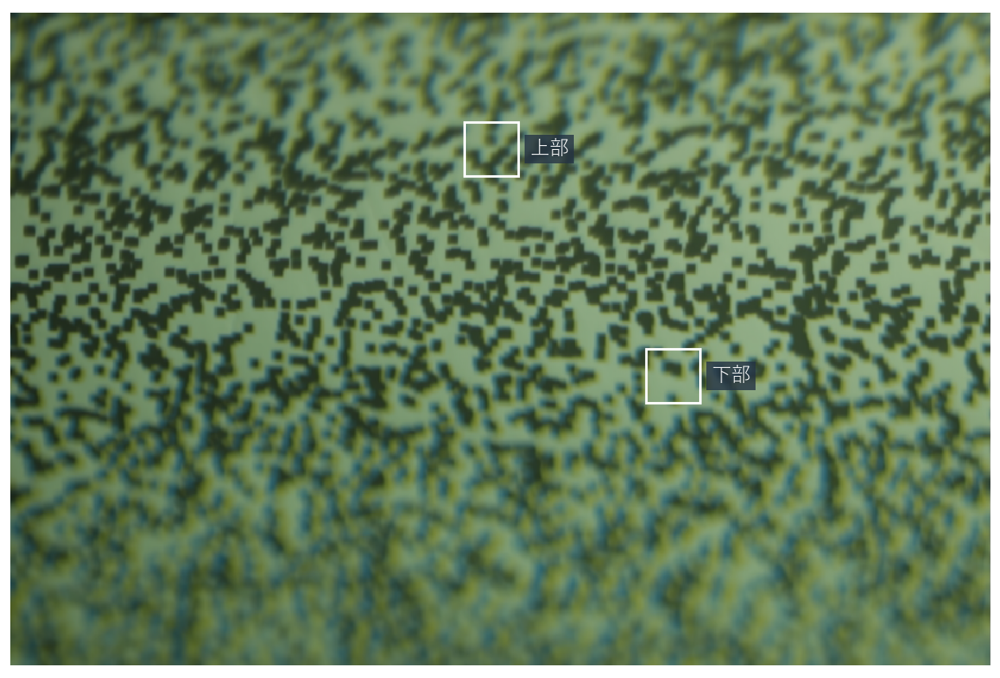
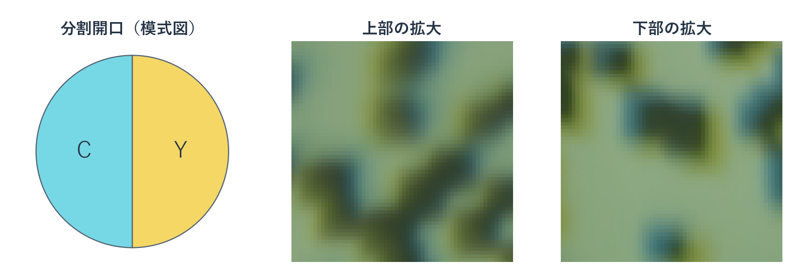
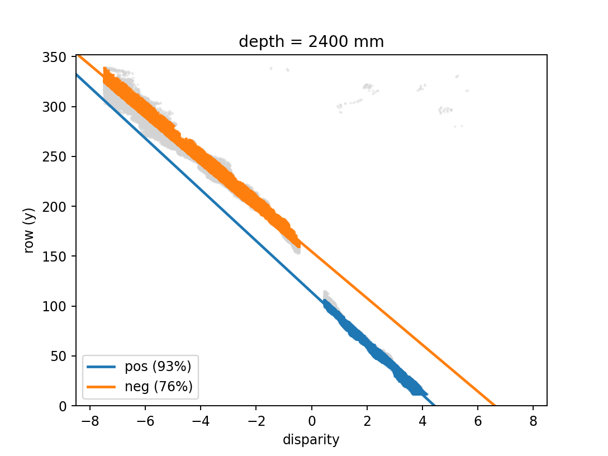
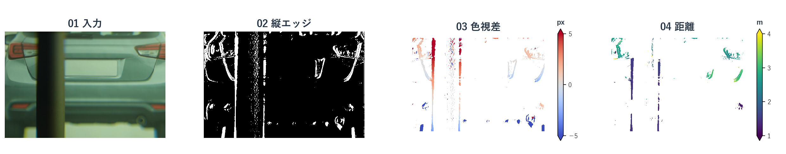

# アオリ光学系とカラーフィルタ開口による単眼ビデオレート測距

1台のカメラにアオリ光学系と分割型カラーフィルタ開口を組み合わせ、映像の色ずれから距離をフレームごとに求めるリアルタイム実装。


手前の筒と奥の印刷画像の例。色の付いた点が推定距離で、背景には入力画像を重ねている。

## このリポジトリについて

アオリ光学系と色視差による単眼測距を実際に動くシステムにした**過去の実装例**で、読んで理解したり、参考・拡張したりするために公開している。視差計算の骨格は [TiltedOpticsDepthIntro](https://github.com/aoifukino/TiltedOpticsDepthIntro)（MIT）のコードが元で、Rust への移植、RANSAC による校正、映像入出力、リアルタイム表示を加えた（[NOTICE](NOTICE)）。無保証で、更新・サポートの予定はない。実機が変わると再校正が必要になる。

## 測距の原理

ぼけによる色ずれの大きさと、画像のどの行に写ったかの2つから距離を求める。以下の撮影画像と散布図は、2.4 m に置いた同じパターン板の撮影から作成した。

### 1. アオリ光学系：行ごとにピントの合う距離が変わる

通常のカメラでは、画面全体で同じ距離にピントが合う。レンズを傾けると合焦面が傾き、画像の行ごとにピントの合う距離が変わる。本装置では、上の行ほど遠く、下の行ほど近い距離にピントが合う。これにより、通常の単眼カメラより広い距離範囲で、ぼけを距離の手掛かりにできる。


そのため、同じ距離の板を撮影しても、ピントの合う中央付近だけが鮮明で、上下の端に近いほどぼける。



### 2. 分割型カラーフィルタ開口：ぼけが色ずれになる

開口を左右でシアン（C）とイエロー（Y）に分ける。赤の光はイエロー側、青の光はシアン側の半開口だけを通る。ピントが合った点ではどちらの光もセンサ上の同じ位置に集まるが、ピントが外れると赤の像と青の像が左右逆向きにずれる（色視差）。色視差はピントの合う距離から離れるほど大きく、手前か奥かで向きが反転する。



上の写真の白枠を拡大したもの。上部では板がその行のピントの合う距離より手前、下部では奥にあるため、色の並びが反転している。

### 3. 行と色視差から距離を求める

色視差は、物体の距離と写った行の両方で決まる。そこで、既知の距離で撮影した画像から両者の関係を求めておく（校正）。下図は2.4 mの板から得た行 y と色視差 d の散布図で、点はほぼ直線 `y = a·d + b` に並ぶ。上部（pos、d > 0）と下部（neg、d < 0）で符号が分かれるのは、2の拡大画像で色の並びが反転していたのと同じ理由である。直線を色視差0まで延ばした行 b（図では pos が約115行、neg が約155行）が、2.4 m にピントが合う行の目安になる。図のように正負で直線が異なるため、以降の係数も正負で別々に求める。



距離を変えて撮影し b を集めると、ピントの合う行と距離 z の関係 `b = v/z + u` が得られる。推論では、写った行 y と色視差 d から「色ずれを0に戻したときの行」`y − ā·d` を求め（ā は各距離での傾き a の平均）、この関係に当てはめて距離を出す。

```text
z = v / (y − ā·d − u)
```

係数 v・u・ā は色視差の正負（図の pos・neg）ごとに持ち、推論時は d の符号で使い分ける。

## 処理の流れ



色ずれは水平方向にしか生じないため、縦エッジ付近で色視差を求め、有効な視差を距離へ変換する。Pythonが入出力・表示、Rustが視差計算を担当する。

| 段 | 内容 | ファイル |
|---|---|---|
| 1. 前処理 | 1280×720 を 3:2 に中央切出しし、528×352 に縮小 | `realtime/camera.py`（`preprocess`） |
| 2. R/B 分割 | 赤（基準）と青（探索側）に分ける | `realtime/pipeline.py` |
| 3. 縦エッジ選別と ZNCC | 水平 Sobel の勾配画像で、赤の勾配が閾値（`EDGE_TH`）を超える画素だけを対象にする。赤の窓（`KERNEL_SIZE`）に対し青の窓を水平に `SEARCH_RANGE_X` 通りずらして ZNCC（正規化相互相関）を計算し、最大のずれを放物線補間して符号付きの色視差 d とする。決められない画素は NaN | `core/disparity.py`、`rust/disparity/src/lib.rs`（本体）、`core/_disparity_reference.py`（照合用の Python 実装） |
| 4. 有効な視差の帯 | \|d\| が小さすぎる（合焦面付近）か大きすぎる画素を NaN にする（`INFER_BAND_LOW`/`HIGH`） | `realtime/pipeline.py`、`config.py` |
| 5. 距離への変換 | 参照式に行 y・色視差 d・係数（`params/fit_result.csv`）を当てはめる | `core/depth.py`、`core/params.py` |

校正は `calibration/`（`calibrate.py` で距離ごとの行 b と傾き a を RANSAC で求め、`fit_params.py` で係数 v・u・ā を決める）。コードは `realtime/pipeline.py` → `core/` → `calibration/` → `realtime/runner.py` の順に読むとよい。定数は `config.py` に集約している。

## 使用機材

| 項目 | 内容 |
|---|---|
| カメラ | Canon EOS R10（センサ 22.3×14.9 mm、有効約2,420万画素） |
| レンズ | FUJINON SWD 90mm F5.6 |
| アオリ機構 | アオリ撮影用アダプタ |
| 開口フィルタ | 開口を左右でシアンとイエローに2分割したカラーフィルタ |
| 映像入力 | EOS Webcam Utility Pro（USB）。1280×720を3:2に中央切出しし、528×352に縮小して処理 |

## 実行手順

**環境**：Windows 11 / PowerShell、Python 3.14（uv）、Rust（cargo）、maturin（`uv tool install maturin`）。他の OS は未検証。

最初にRust拡張をビルドして導入する（無いと視差計算を使うコードと `pytest` が動かない）。`uv sync` を実行すると導入した拡張は削除されるので、実行後はやり直す。

```powershell
uv sync
cd rust\disparity
maturin build --release --interpreter ..\..\.venv\Scripts\python.exe
uv pip install (Get-ChildItem target\wheels\*.whl).FullName
cd ..\..
```

```powershell
# データも実機も不要
uv run python -m pytest
uv run python -m realtime.runner --source still --path assets\sample\calib_2400mm_raw.png --no-record   # 同梱サンプルの距離マップ（q / Esc で終了）

# 実機（WB・露出を固定し、EOS Webcam Utility Proでカメラ映像を供給）
uv run python -m calibration.capture_calib      # 初回・光学配置の変更時：校正画像の取得
uv run python -m calibration.calibrate
uv run python -m calibration.fit_params         # 係数を params/ に保存（同梱の係数は上書きされる）
uv run python -m realtime.runner --source webcam --no-record
```

同梱の係数（`params/`）は著者の装置・設定のもので、1.4〜3.2 m の校正に基づく。範囲外は外挿で、精度は保証しない。`data/` の下は空で、校正画像や撮影データは同梱していない。`checks/` の検証と `tools/` の解析は、自前の撮影データ（と正解距離）が要る。

リアルタイム表示は、左に入力画像、右に距離マップ（0〜5 m。近いほど赤、遠いほど青。無効・範囲外は黒）を並べる。`v` で直近 4 フレームの有効画素を残す表示（ちらつき低減。表示だけ）、`h` で説明の表示/非表示、`q` / `Esc` で終了。

<details>
<summary>記録と再生</summary>

```powershell
uv run python -m realtime.runner --source webcam --session demo_01 --record-video
uv run python -m tools.play_session_videos --session demo_01
```

入力は `data/captures/<session>/`、距離NPY・表示画像・実行条件は `outputs/<session>/` に保存する。閲覧用動画も同時に記録する。

</details>

## ライセンス・引用

- ライセンス: [BSD-3-Clause](LICENSE)（無保証）
- 元コードの表示: [NOTICE](NOTICE)（MIT ライセンスのコードを元にした部分）
- 引用情報: [CITATION.cff](CITATION.cff)

## 参考資料

- [TiltedOpticsDepthIntro](https://github.com/aoifukino/TiltedOpticsDepthIntro)：アオリ光学系による距離推定の入門資料・関連実装（MIT）。
- [OpenCV](https://opencv.org/) · [uv](https://docs.astral.sh/uv/) · [maturin](https://www.maturin.rs/) · [EOS Webcam Utility Pro](https://personal.canon.jp/product/camera/software/webcam-utility-pro)

<details>
<summary>参考論文</summary>

- H. Michi et al., “Distance Estimation Using Two Different-Aperture Images Obtained by Tilted Lens Optics Camera,” ISPACS 2012. [書誌情報](https://www.rs.tus.ac.jp/hamalab/publications2012.html)
- A. Fukino et al., “Accuracy Improvement of Depth Estimation with Tilted Optics and Color Filter Aperture,” IWAIT 2023. [DOI](https://doi.org/10.1117/12.2666826)
- A. Fukino et al., “Depth Estimation with Tilted Optics Using Split Color Filter Aperture,” ICECET 2024. [DOI](https://doi.org/10.1109/ICECET61485.2024.10698532)
- 金子奨波ほか, 「カラーフィルタ分割開口とアオリ光学系を用いた深度推定手法の提案」, 映像情報メディア学会技術報告, 49(14), 2025. [学会目次](https://www.ite.or.jp/ken/index/ite-techrep-49-14.html)
- V. Paramonov et al., “Depth Camera Based on Color-Coded Aperture,” CVPR Workshops, 2016. [論文](https://openaccess.thecvf.com/content_cvpr_2016_workshops/w16/papers/Paramonov_Depth_Camera_Based_CVPR_2016_paper.pdf)

</details>

<details>
<summary>掲載画像について</summary>

実写は、著者が用意した被写体（車を印刷した紙、パターン板）を著者が撮影した画像で、処理結果は本システムの出力である。撮影後の画像にAI生成・輪郭強調・色調補正は使っていない。画像もコードと同じ BSD-3-Clause で提供する。図の距離の表示範囲は1〜4 mで、測定可能範囲を意味しない（リアルタイム表示は 0〜5 m・黒背景）。

光学系の模式図は、金子ほか 2025 の図2と Fukino ほか ICECET 2024 の Fig.4(b) を参考に独自に描き直したもので、論文画像の転載・トレースではなく、実機の寸法や角度も表さない。TiltedOpticsDepthIntro の画像は転用していない。

</details>
